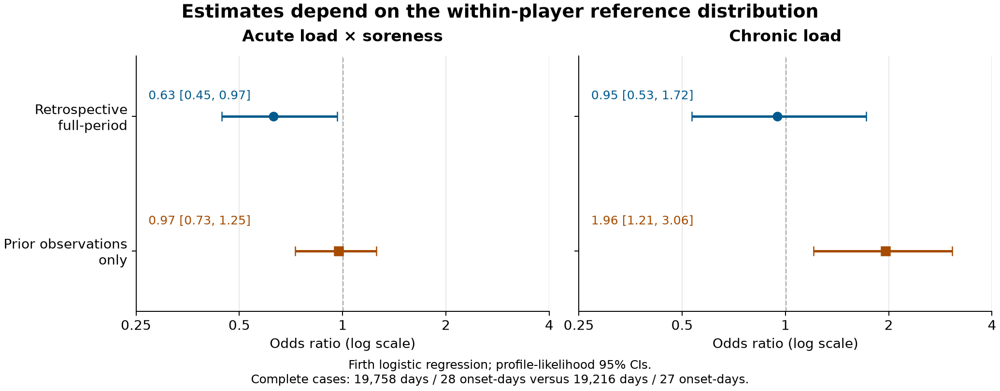

# SoccerMon: load, wellness and lower-limb pain

A reproducible study of **within-player athlete monitoring**, using two elite
Norwegian women's football teams across the 2020–2021 seasons.

**Yushuo Liu · Yunnan Normal University**

Associated manuscript: *Within-player load–wellness monitoring and lower-limb
pain in elite female football: a reproducible secondary analysis of the
SoccerMon dataset*. Revised manuscript under review at PLOS ONE; no publication
or acceptance is claimed here. This repository is currently private.

## Research question

Are deviations from a player's usual training load and wellness associated
with next-day onset of a self-reported lower-limb pain/injury episode, and how
stable are the estimates to exposure construction, sparse events and missing
monitoring?

The reference risk set has **36,296 player-days and 42 onset-days from 15
players**. The soreness complete-case sample has **28 onset-days from nine
players**. This information limit remains the same across the overlapping
model specifications. The analysis estimates associations; it is not a
validated injury prediction tool.

## A central sensitivity result



Retrospective full-period standardization and backward-looking
standardization lead to materially different estimates. The latter uses only
observations available before each day and reduces the complete-case sample
to 19,216 days and 27 onset-days. Sparse events, team separation and selection
from incomplete monitoring also limit interpretation. Full details are in
[study definitions](docs/STUDY.md).

The figure is generated from frozen structured results. Its intervals are
profile-likelihood 95% CIs, not player-cluster bootstrap intervals. The
[underlying table](reports/standardization_sensitivity_data.csv) and
[provenance](reports/figure_provenance.json) are included. It is a portfolio
illustration, separate from the submitted figures.

## Reproduce and inspect

```bash
uv sync --frozen
uv run python scripts/pipeline.py verify-frozen
uv run python scripts/pipeline.py plot
uv run python scripts/pipeline.py rebuild
uv run python scripts/pipeline.py diagnostics
```

`rebuild` obtains the small public `subjective.zip`, verifies its SHA-256,
and regenerates the analytical dataset. Use `--raw-zip /path/to/subjective.zip`
for an existing local copy. Raw data and player-level derived files stay in
the ignored `workspace/` directory.

For R setup, independent focal model refits and the full B=2,000 workstreams,
see [the reproduction guide](docs/REPRODUCING.md). The guide distinguishes
fresh calculations from audits of stored results. The dated
[verification report](reports/VALIDATION.md) records exactly what has run.

## What this repository demonstrates

- Raw-data integrity checks and explicit recurrent-event risk sets.
- Lagged exposure construction, canonical wellness coding and within-player
  scaling, including an expanding-history sensitivity.
- Sparse-data and separation diagnostics, Firth estimation, mixed-model
  fallback rules and whole-player uncertainty analysis.
- Missingness/IPW diagnostics and sensitivity analyses for team, season,
  exposure windows and event-player influence.
- A frozen analysis plan, model registry, structured results and
  independently checkable provenance.

## Repository map

| Location | Contents |
|---|---|
| `analysis/core/` | Portable data reconstruction and R1 analysis scripts |
| `analysis/sensitivity/` | Original frozen R2 workstreams, staged by the runner |
| `protocol/revision_sap/` | Frozen revision SAP, model matrix and missing-data plan |
| `reproducibility/frozen/` | Frozen reference outputs, separate from fresh outputs |
| `reproducibility/` | Source hashes and derived-data fingerprints |
| `scripts/` | Runner, focal model verification, R setup and figure generation |
| `reports/` | Figure, source table and dated verification report |

## Source and citation

SoccerMon was created by Midoglu and colleagues. Data source:
[Zenodo, DOI 10.5281/zenodo.10033832](https://doi.org/10.5281/zenodo.10033832).
The unchanged preregistration is
[OSF, DOI 10.17605/OSF.IO/UAFWQ](https://doi.org/10.17605/OSF.IO/UAFWQ).
The revision SAP and subsequent R2 sensitivity taxonomy are kept distinct.
An article DOI will be added only when one is available.

The original submission archives remain unchanged and are identified in
`reproducibility/source_archives.json`. Raw ZIP files, installed software,
manuscript drafts and reviewer correspondence are not redistributed here.
No new code or data license has been assigned during this staging work.
